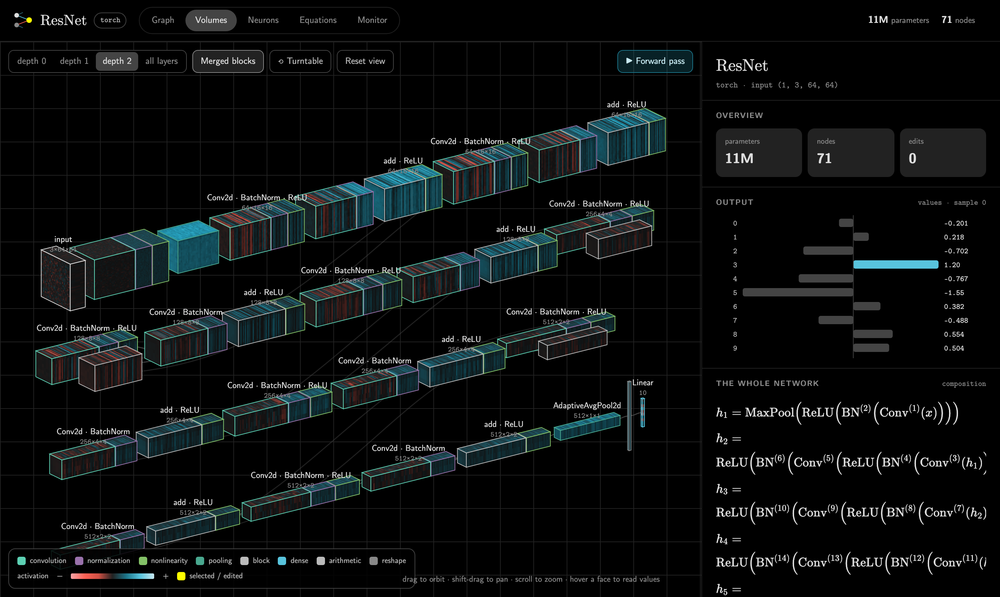
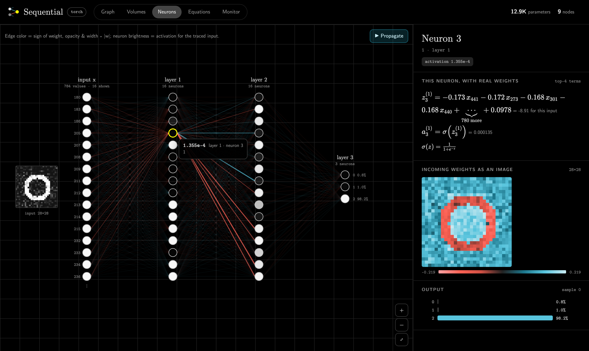

# deepvis

Wrap **any** PyTorch, JAX (Flax linen, Flax NNX, Equinox, or a plain `apply_fn(params, x)`) or Keras 3
network — or **open a saved file** (ONNX, `.keras`, a `torch.export` program, a state_dict or `.safetensors`) —
then **focus** on any part of it, **monitor** intermediate layers, **unroll** it into mathematics,
**play** with its weights, activations and inputs, and **see** all of it in 3Blue1Brown style: an
interactive dashboard with 2-D and volumetric 3-D views, and [manim](https://github.com/ManimCommunity/manim) videos.
Every color comes from manim's own palette.


<sub>The 60-second tour inside VS Code ([MP4](https://batuoz.com/deepvis/media/deepvis-teaser.mp4), [full-size GIF](https://batuoz.com/deepvis/media/deepvis-teaser.gif)); a slower walkthrough: [the VS Code introduction](https://batuoz.com/deepvis/media/deepvis-vscode-intro.mp4).</sub>



```python
import deepvis as dv

net = dv.visualize(model, x)                # the one call: wrap, run on x, show inputs, every tensor, outputs
                                            # (browser, or inline in Jupyter) — and keep the wrapper:
net = dv.wrap(model, sample_input=x)        # torch / flax / nnx / equinox / (apply_fn, params) / keras
net = dv.open("model.onnx")                 # or a saved file: .onnx .keras .pt2 .pt .safetensors .npz
net.show(x)                                 # interactive dashboard (inline in Jupyter)
net.serve(x)                                # …live: draw inputs, edit weights, intervene, in the browser
print(net.equation())                       # h₁ = σ(W⁽¹⁾vec(x) + b⁽¹⁾) … ŷ = softmax(W⁽³⁾h₂ + b⁽³⁾)
net["fc1.weight"][:, 3] = 0                 # weight surgery — recorded, undoable, replayable
with net.intervene("relu1", dv.ablate([7])):  # activation-level knockouts
    y = net(x)
net.animate("volumes", x, path="tensors.mp4")  # a manim ThreeDScene of the network's tensors

dv.export_html(model, x, "model.html")      # one call → a self-contained interactive page
dv.export_svg(model, x, "model.svg")        # … or a static figure with the same expressive glyphs
```

### It is general-purpose

The same calls work on everything below (all covered by the test suite): outputs match the native model,
the graph includes functional ops (residual `+`, `cat`, `softmax`, `.T`, reshapes), and every layer can be
traced, unrolled, edited and intervened on.

| model | what it exercises |
|---|---|
| torchvision ResNet-18, MobileNetV3 | residual adds, BatchNorm, Hardswish, squeeze-excite `mul` |
| torchvision VisionTransformer, `nn.TransformerEncoder` | attention (maps captured), class token, fused fast path |
| LSTM / GRU | tuple outputs, recurrent layers |
| U-Net | skip concatenations, transposed convolutions |
| two inputs → dict of outputs | multi-input / multi-output graphs |
| weight tying, a module called twice | shared parameters (`… E⁽¹⁾ᵀ`), call instances |
| Flax attention + BatchNorm, Equinox CNN, pure-JAX `lax.scan` RNN | JAX flavors, running stats, loops |
| HuggingFace GPT-2, BERT, Llama, T5 | HF layer classes recognized by name (GPT-2's `Conv1D` as an (in, out) Linear, `LlamaRMSNorm`, `NewGELUActivation`, rotary embeddings), fused SDPA attention (patterns recomputed: identical to `output_attentions=True`, causal / padding masks and grouped-query heads included), a fresh KV cache's `cat(∅, k)` elided, never-run modules hidden |
| torchvision ResNet-50, ViT-B/16, ConvNeXt-T | size: 2–3 s exports, 4–6 MB self-contained pages (adaptive budgets, 8-bit quantized maps) |
| timm ResNet, ViT/DeiT, ConvNeXt, EfficientNet | `unbind`-style q/k/v (multi-output ops get one node per output), hundreds of `Identity` / `Dropout(0)` placeholders (traced, hookable, not drawn), 3-D `cls_token` / `pos_embed` parameters |
| a module with no submodules (pure functional `forward`) | traced into its ops rather than drawn as one box |

#### Saved files, ONNX, Keras and `torch.export`

`dv.open(path)` (and `deepvis open|export <file>` on the command line) reads a model from wherever it was saved;
`dv.wrap` and `dv.visualize` take the same paths.

| file | what you get |
|---|---|
| `.onnx` | any exported network — PyTorch (both exporters), TensorFlow / Keras via `tf2onnx`, scikit-learn … — run in onnxruntime. Layers come from the exporter's module scopes (`layer1.0.conv1`, with their classes from the dynamo exporter's metadata); a decomposed attention or GELU folds back into one node; BatchNorm folded into a convolution and tensors the exporter stored once are traced back to their layers. Trace it, edit its weights (`net.backend.save("edited.onnx")`), make its page; interventions and gradients need the original model. |
| `.keras` / `.h5` | a Keras 3 model on the JAX, PyTorch or TensorFlow backend (the same as `dv.wrap(keras_model, sample_input=x)`): Sequential, functional and subclassed models, nested models as containers, a shared layer drawn per call, functional ops (`keras.ops.relu` on a symbolic tensor) as nodes, a layer's own `activation=` in its explanation and equations; weights edited in place, interventions on any layer. |
| `.pt2` | a `torch.export` program: its module tree and classes come back from the export's metadata — the same graph as the module it came from, still a live PyTorch module (interventions, gradients). `dv.wrap(exported_program)` works too. |
| `.pt` `.pth` `.bin` `.ckpt` | `torch.load(weights_only=True)`: a state_dict (or a checkpoint holding one) opens as a **weights-only view**. A file with a whole pickled module runs code when loaded, so it needs `trusted=True` (`--trust`). |
| `.safetensors`, `.npz` | a weights-only view, read lazily: a 7B checkpoint opens in seconds, bfloat16 included. |

A weights-only view draws one node per module path, its kind guessed from the tensors it holds (a 4-D `weight` is a
convolution, `running_mean` means BatchNorm, `in_proj_weight` attention …), with every tensor's values, statistics and
histograms. There is no code to trace, so layers are linked in name order — alphabetical `.safetensors` files are put
back in computation order (embeddings, then per block norm → attention → norm → MLP, then the head) — and the page
says so.

Inputs can be a dict too: a tokenizer's output (`{"input_ids": …, "attention_mask": …}`) is bound to the model's
forward arguments by name.

#### Huge models

A model built on PyTorch's meta device has its architecture and shapes but no numbers and no memory, so any size
draws in seconds: the page shows every layer, shape, parameter count, equation and explanation (marked *shapes
only*; tracing needs real weights).

```python
with torch.device("meta"):
    model = AutoModelForCausalLM.from_config(AutoConfig.from_pretrained("meta-llama/Llama-3.1-70B"))
dv.wrap(model, sample_input=torch.zeros(1, 8, dtype=torch.long, device="meta")).export_html("70b.html")
```

```bash
deepvis export hf:mistralai/Mixtral-8x7B-v0.1 --meta -o mixtral.html   # config only: ~5 s, 46.7B parameters
deepvis summary torchvision:vit_h_14 --meta
```

A 7B Llama (1,223 layers drawn) makes its page in 0.5 s and a 70B one (3,047) in 4 s; pages ship each distinct
glyph once, values that every layer reads (rotary embeddings, masks) are drawn as one faint line rather than routed
through every row, and live pages compress their updates.

#### Compatibility: the model zoo

<!-- zoo-summary:start -->
61 of 61 architectures — from Hugging Face, JAX, Keras, ONNX, custom, timm, torchvision — wrap, trace to the native model's output (to 1e-4) and make a page in the test suite: [the full table](docs/zoo.md).
<!-- zoo-summary:end -->



## Install

```bash
pip install deepvis                 # the core needs only numpy
pip install "deepvis[torch]"        # or pick extras: [torch] [jax] [keras] [onnx] [widget] [figures] [anim] [sympy] [all]
```

From a checkout, for development:

```bash
conda create -n deepvis python=3.12 && conda activate deepvis
pip install -e ".[all,dev]"
```

Notes:

* **Animations** need ManimCE (`[anim]`), which needs `cairo`/`pango` (`brew install cairo pango pkg-config`).
  If `pip` can't build `pycairo` (e.g. the Xcode license hasn't been accepted), use
  `conda install -c conda-forge pycairo` first.
* **TeX in videos:** with `latex` + `dvisvgm` on your PATH, equations are typeset by TeX. Without them,
  deepvis renders the same LaTeX via Pango in Computer Modern (CMU Serif if installed): italic variables,
  real super/subscripts. On MacTeX/BasicTeX: `sudo tlmgr install dvisvgm`.
* **Dashboard math** is typeset by KaTeX, loaded from a CDN (offline, the TeX source shows instead). For pages
  that never touch the network, pass `offline=True` (or set `DEEPVIS_OFFLINE=1`): the bundled KaTeX is inlined,
  about 0.7 MB more per page. The VS Code extension always does this.
* Tested with torch 2.14, jax 0.11.1 and 0.12.1, flax 0.12.9 and 0.12.12, equinox 0.13.8, manim 0.21.
  (flax 0.12.9's NNX does not import with jax 0.11.2, so pin `jax==0.11.1` if you use NNX with that flax.)

## In VS Code

The [deepvis extension](vscode/README.md) — **deepvis** by *batuoz* on the VS Code Marketplace
(`ext install batuoz.deepvis`) — shows the page in a panel beside your code:

* **Visualize** above any `dv.visualize(model, x)` call.
* **Visualize net…** above a line that makes a model. It asks for the inputs.
* Right-click a name → **deepvis: Visualize model here…** (`⌘⌥V`).

Your unsaved edits are what runs, and saving re-makes the page. A failure puts a squiggle on its line with the fix.

* **Notebooks:** the same links work in Jupyter cells, and **deepvis: Visualize a live model…** in the notebook
  toolbar lists the models and tensors already in the kernel. Nothing is re-run, so you see the trained weights.
* **Training runs:** a page served by `dv.visualize(..., live=True)`, `dv.watch(...)` or `net.serve(...)` opens
  in the panel instead of a browser tab. This works whether the script runs from the extension, the integrated
  terminal or a notebook.
* **Compare with checkpoint…** in the panel's toolbar puts the current model next to a `.pt` / `.safetensors`
  file.

To build it from a checkout instead: `cd vscode && npm install && npm run package && code --install-extension deepvis-0.3.0.vsix`.

The same runner works from a terminal: `python -m deepvis.capture page.html train.py --line 40 --model net
--inputs x` writes the page for `net` on `x` as they are right after line 40, then stops the script.

## A tour

[**The tour**](docs/tour.md) goes through every feature with code and pictures: wrap and focus, monitor, unroll into mathematics, manipulate weights, intervene on activations, export (HTML, SVG, PNG, PDF), notebooks, W&B and TensorBoard, live pages, language models and the logit lens, inside attention, attribution, comparing checkpoints, datasets, diffusion, training from the page, and manim animations.

## When something goes wrong

Errors say what happened and what to do, in terms of your model and inputs — the model's own traceback stays
attached underneath:

```text
deepvis.errors.RunError: the model raised RuntimeError when run on the inputs: mat1 and mat2 shapes cannot be
multiplied (3x7 and 5x8)
  → fix: a Linear layer expects 5 features in the last dimension but got 7 (inputs: (3, 7)). Reshape the input,
    or check the first layer's in_features.
```

Covered: the class instead of an instance, `None` / dict / empty inputs, wrong feature counts, channels, dimensions,
dtypes, token ids beyond the vocabulary, missing forward arguments, flax variables and JAX shape mismatches,
misspelled options and views (with *did you mean*), unwritable paths, busy ports, unknown model names in the CLI,
denoisers with the wrong signature, and — for scripts run from the VS Code extension — syntax errors, missing
packages, timeouts and out-of-memory kills, pinned to the failing line. Harmless mismatches just work: numpy arrays
and plain lists become tensors, inputs move to the model's device, missing output folders are created. Requests that
can't apply (e.g. `start="attention"` for a model without attention, labels of the wrong length) raise a
`DeepvisWarning` and the page is still made. All errors subclass `deepvis.DeepvisError` and the matching built-in
(`ValueError`, `TypeError`, …).

## Examples

`examples/` has runnable scripts (outputs go to `examples/out/`): a trained MLP (01), CNN pruning (02),
transformer attention and patching (03), Flax linen (04), NNX (05), Equinox (06), plain JAX (07), a
weight-surgery tour (08), monitoring during training (09), the live playground on a trained classifier (10),
the animations (11), a zoo of real architectures (12), exporting pages and figures (13), a live
dashboard that follows a training loop, in PyTorch or Flax (14), a CNN you train with a button on its
page (15), a diffusion model inside and out (16), and a Flax CNN trained from its page with optax (17).

**Gallery:** `python docs/build_gallery.py` builds one page per showcase (MLP, attribution, attention, LSTM, mixture
of experts, graph network, before/after, training replay, diffusion, ViT), with thumbnails, an index and the
API reference, into `docs/site/`. The `site` workflow publishes it at https://batuoz.com/deepvis/.

## Design

```
src/deepvis/
  core/        graph IR (module tree + dataflow DAG), canonical layer kinds & weight roles, selectors, stats
  backends/    torch_backend.py (dispatch tracer, fx, hooks) · jax/ (jaxpr engine + linen/nnx/equinox/pure adapters)
  manipulate/  edit ops, serializable edits, history, ParamRef / neuron selections, interventions
  monitor/     Trace, Monitor, TrainingLog (metrics + per-layer learning dynamics)
  equations/   expression tree (LaTeX + Unicode), per-kind rules, unrolling modes
  viz/         expressive glyphs (glyphs.py), static SVG diagrams, dashboard payload, layered DAG layout,
               HTML/CSS/JS app, 3-D renderer, live server (edits, interventions, training updates)
  anim/        manim data builders, mobjects, scenes, renderer, LaTeX→Pango fallback
  cli.py       `deepvis export` / `deepvis summary`
  diffusion.py DDPM / DDIM sampling that records xₜ, x̂₀, ε̂ for the Diffusion tab
```

Colors are manim's palette (`deepvis.theme`, exact values from manim's config): a black canvas with
`GREY_E`/`GREY_D` surfaces and `GREY_A`/`GREY_B`/`GREY_C` text; weights and signed activations use a
`RED_A … RED_E · GREY_E · BLUE_E … BLUE_A` diverging map (3b1b's red-negative / blue-positive convention);
magnitudes use the `BLUE` ramp; `YELLOW_C` marks selection. Layer families take manim hues (dense `BLUE_C`,
conv `TEAL_C`, pooling `TEAL_E`, attention `GOLD_C`, embedding `MAROON_C`, recurrent `PINK`, norm `PURPLE_C`,
nonlinearity `GREEN_C`); every node and block also prints its kind, so color is never the only cue.
The dashboard's 3-D views use a small dependency-free orthographic renderer (`volume3d.js`): each face is an
affine image of a texture, so voxels stay crisp and hover reads exact values.

## Limitations

* PyTorch persistent monitors/interventions on functional ops replay the traced op order; if your forward
  takes a different branch than the traced call, the mismatched ops are left alone (never patched wrongly).
  Models that only trace through the fx / hook fallbacks attach persistent hooks to modules only.
* JAX has no hooks: monitors and interventions apply when you call `net(x)` (jit-compiled), not the raw
  `model.apply`.
* PyTorch's fused transformer fast path is disabled while deepvis traces or records, so every sublayer
  is visible. Monitors on `nn.TransformerEncoderLayer` submodules won't fire if *you* run it under
  `torch.no_grad()` with the fast path enabled.
* Scalar (per-value) equations cover dense layers and convolutions (through BatchNorm and activations);
  attention appears in compact form with its definition.
* Very large graphs (hundreds of layers) lay out more slowly; the dashboard opens at a collapsed depth, and the
  Volumes view wraps long networks into rows.
* `srv.update()` runs the dashboard's forward pass on your training thread (that's what keeps it safe);
  editing weights from the browser *while your own loop* is training races with the optimizer. With
  `serve(..., train_step=fn)` the page drives training and edits wait for the current step.
* The logit lens runs a torch model's own norm and head; JAX models pass `lens_fn`. Attention patterns of fused SDPA
  kernels are recomputed from q and k; beyond ~64 MB per call (very long sequences) they are skipped.
* Attribution, head importance, MoE routing and recurrent unrolling are PyTorch-only. Heads can be switched off
  in `nn.MultiheadAttention` and `F.scaled_dot_product_attention`. Unrolling assumes the recurrent layer starts
  from a zero state, and is shown only when it reproduces the layer's output.
* Parameter counts exclude buffers (BatchNorm running statistics); `net.num_params(False)` includes them.
* ONNX models run in onnxruntime, which has no hooks: they trace and edit, but interventions and gradients need the
  original PyTorch / JAX model. Keras models record each layer call as it runs: plain Python arithmetic between
  layers in a *subclassed* model (`h + self.block(h)`) isn't seen, so such a skip is drawn as a link from the previous
  layer (functional models record every op); gradients for Keras models aren't wired up yet.
* A model on the meta device has no numbers: its page shows the architecture, shapes and equations, and `trace()`
  explains it needs real weights. Mixture-of-experts layers in `--meta` mode use Transformers' batched kernel (the
  eager one routes on data).
* Keras needs a backend that is installed: set `KERAS_BACKEND` (`jax` or `torch`) before importing Keras;
  `dv.open("model.keras")` picks one if you haven't.
* 3-D faces show channel / row / column means of each tensor (the side panel's slice stack shows individual
  channels). Drawing on a multi-channel image input sets every channel.

## Tests

```bash
pytest                     # ~340 tests: core, torch, jax (linen/nnx/equinox/pure), Keras, ONNX files,
                           # torch.export, weights-only files, 5-framework parity, the model zoo, HuggingFace
                           # models, meta-device pages, equations (conv scalars checked exactly), gradient
                           # flow, functional-op hooks, glyphs + HTML/SVG/PNG/PDF export (strict-XML checked),
                           # dashboard payload + live playground, the notebook widget, dataset profiles (vs
                           # NumPy), W&B / TensorBoard, training updates, CLI, headless-browser (graph,
                           # glyphs, 3-D volumes, KaTeX, live training, Dataset tab, widget channel), manim
                           # renders, capture / notebook kernels, attribution, heads, compare, RNN / MoE views
pytest -m "not anim and not browser and not zoo_slow"   # skip the slow ones
pytest -m zoo                          # the model zoo: ~60 architectures (incl. ONNX files, Keras) wrap, trace, export
KERAS_BACKEND=torch pytest -m keras    # Keras tests run on the backend KERAS_BACKEND names (default: jax if installed)
```

## References

* [3b1b/manim](https://github.com/3b1b/manim) — the visual language deepvis follows: the exact manim palette
  (`deepvis.theme`), the neural-network conventions of the 3Blue1Brown series, and the animations (ManimCE).
