# A tour of deepvis

Everything deepvis does, one feature at a time. Back to the [README](../README.md).


### Wrap and focus

```python
net = dv.wrap(torch_model, sample_input=x)
net = dv.wrap(linen_module, variables, sample_input=x)
net = dv.wrap(nnx_module, sample_input=x)
net = dv.wrap(eqx_module, sample_input=x)
net = dv.wrap(apply_fn, params, sample_input=x)     # any pure JAX function

net.summary()                       # module tree with shapes and parameter counts
net.graph                           # framework-agnostic IR: module tree + dataflow DAG
block = net["encoder.layers.1"]     # a NodeView: most Net verbs, scoped to this sub-network
layer = net.focus("fc1")
sel = net.select("blocks.*.fc", kind="Linear")      # glob / "re:" regex / kind / predicate
```

The graph shows **functional ops** too — residual `+`, `softmax`, reshapes, a learned positional
parameter — not just modules. For PyTorch, deepvis runs your model once under a `TorchFunctionMode`
with module hooks (following real control flow, so `nn.TransformerEncoder` works); without a sample
input it falls back to `torch.fx`. For JAX, every flavor is traced to a jaxpr with module boundaries
marked by named scopes; equations are grouped into module nodes and readable op clusters (a run of
`exp`/`reduce_sum`/`div` becomes one `Softmax` node). Plain JAX functions get **inferred layers**:
`x @ W + b` becomes a `Linear` node, and `with dv.scope("readout"):` names a region.

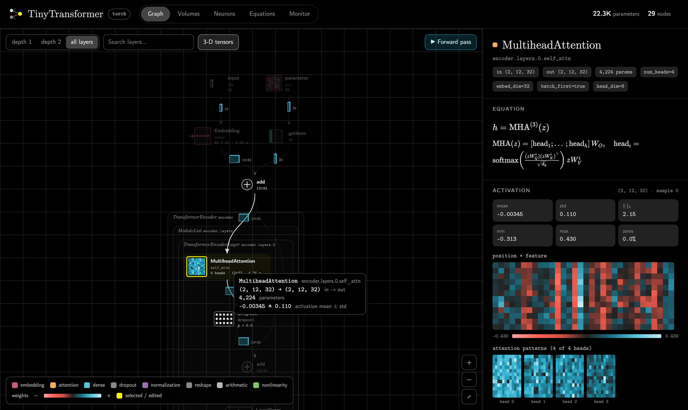

### Monitor

```python
tr = net.trace(x)                         # every intermediate, one forward pass
tr["blocks.0.ln"], tr.inputs["fc1"], tr.attention["encoder.layers.0.self_attn"]
print(tr.table())                         # mean / std / min / max / sparsity per layer

tr = net.trace(x, grads=True, loss_fn=lambda y: y[:, 0].sum())
tr.grads["blocks.0.fc"], tr.param_grads["inp.weight"]      # ∂L/∂activation, ∂L/∂θ (torch and JAX)

mon = net.monitor("fc*", "relu*", "@add", stats=("mean", "std", "sparsity"), grads=True)
for batch in loader:                      # torch: hooks fire even when you call the raw model,
                                          # functional ops (residual "@add", softmax, split outputs) included
    loss = ...; loss.backward(); opt.step()
    mon.step()
mon["relu2"].series("sparsity")           # dead-ReLU fraction over training
net.show(x, monitor=mon)                  # timelines in the Monitor tab
```

**Gradient flow.** `net.export_html(path, x, grads=True, loss_fn=...)` (also `show` / `serve`) backpropagates
once and adds a per-layer table of mean / max |∂L/∂output| and |∂L/∂θ| on one log axis, flagging gradients
that vanish or explode on their way back to the input. Each layer's panel shows its gradient drawn like the
tensor itself, and image inputs get a **saliency map** (max |∂L/∂x| over channels); with
`loss_fn=lambda y: y[:, k].sum()` that is "where the input made class k likely".

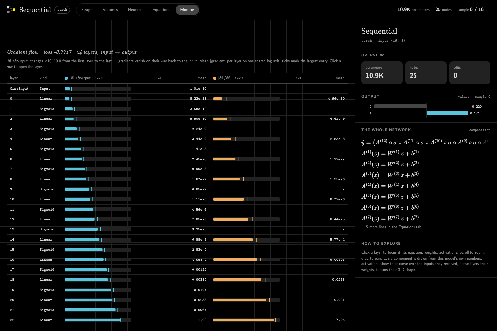

### Unroll into mathematics

```python
net.equation()                 # "system": one line per layer, residuals named h₁, h₂, …
net.equation("expanded")       # substitute everything:  ŷ = softmax(W⁽³⁾σ(W⁽²⁾σ(W⁽¹⁾vec(x) + b⁽¹⁾) + b⁽²⁾) + b⁽³⁾)
net.equation("compact")        # composition:            ŷ = (softmax ∘ A⁽³⁾ ∘ σ ∘ A⁽²⁾ ∘ σ ∘ A⁽¹⁾ ∘ vec)(x)
net.equation(depth=1)          # collapse blocks:        h₂ = Block_0(h₁)
net["blocks.0"].equation()     # just this block (global layer numbering kept)
net.equation("scalar", node="fc2", neuron=3, top_k=4, input=x, levels=2)
#   z⁽²⁾₃ = 0.82·σ(0.51·x₁₂ − …) − 0.61·σ(…) + … + 0.10   (= 2.31 for this input)
net.equation("scalar", node="layer1.0.relu", neuron=(5, 3, 1), input=x)   # a convolution, one output value:
#   z[5,3,1] = 0.122·x[0,7,1] − 0.151·x[2,6,2] + … (23 more) + 0.190      (= 1.33 for this input)
#   ẑ[5,3,1] = 0.707·z[5,3,1] − 0.289                                      BatchNorm folded, real statistics
#   a[5,3,1] = ReLU(ẑ[5,3,1])                                               (= 0.649)
```

Convolution terms follow the layer's real geometry (stride, padding including `same`, dilation, groups;
channels-first or channels-last), so `sum(t["w"] * t["x"] for t in eq.terms) + eq.bias` reproduces the
framework's output exactly. Clicking a convolution in the dashboard shows this for its most active channel.

Every `Equation` has `.latex`, `.text` (Unicode), `_repr_latex_` for Jupyter, a *where* block with
definitions (ReLU, LayerNorm, softmax, multi-head attention, convolution …) and a legend mapping each
symbol to its parameter path and shape (flax kernels are noted as transposed). Register rules for
your own modules with `@dv.equation_rule("MyGate")`. `deepvis.equations.unroll.to_sympy(net)` gives
the exact closed form of tiny dense networks.

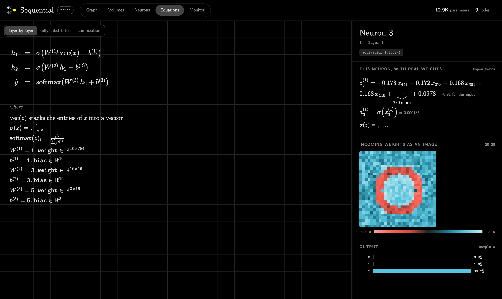

### Manipulate weights

Every edit is a small serializable record applied through `net.apply_edit`, so it lands in
`net.history`: undo/redo, `net.diff()`, JSON export, and replay on another copy.

```python
net["fc1.weight"][:, 3] = 0                        # numpy-style slices (any framework)
net["fc1.weight"][4:8] *= 2                        # in-place arithmetic on regions
net.edit("fc2.weight", "zero", where="abs(w) < 0.01")   # safe mask expressions
net["fc2"].neurons([3, 7]).zero()                  # knock out units (weight rows + biases)
net["conv1"].prune_neurons(0.5)                    # structured pruning by filter norm
net.select(kind="Linear").prune(0.3)               # many layers at once
net["fc3"].low_rank(2); net["fc1"].quantize(bits=4); net["fc1"].noise(0.05, relative=True, seed=0)
net.edit("fc1.bias", lambda b: b.clip(-1, 1))      # any numpy function
net.permute_neurons("fc1", perm)                   # function-preserving symmetry
net.interpolate(other_net, alpha=0.5)              # θ ← ½θ + ½θ_other
net.transplant(other_net, "encoder.**")

with net.edits():                                  # temporary: reverted on exit
    net["fc2"].scale(0.0)
net.undo(); net.redo(); net.reset(); snap = net.snapshot(); net.restore(snap)
log = net.history.export(); other.apply_edits(log) # replay
net.export()                                       # the edited model / params in native form
```

Ops: `set scale add zero noise clamp prune quantize low_rank orthogonalize normalize reinit sign abs
negate shuffle permute mask apply`, plus `permute_neurons interpolate transplant`; add your own with
`@dv.register_op("name")`. NNX edits update your live module in place; Equinox/linen/pure edits come
back through `net.export()`.

### Intervene on activations

```python
with net.intervene("block2", dv.ablate([3, 7])): ...        # zero features
net.intervene("block2", dv.steer(direction, alpha=4.0))     # activation steering (persistent handle)
dv.amplify(2.0, neurons=[5]), dv.clamp(0, 1), dv.mean_ablate(), dv.replace(value), dv.add_noise(0.1)
@dv.intervention
def flip(x): return -x
r = dv.patch(net, clean_x, corrupted_x, at="encoder.layers.0.norm2")   # activation patching
r.recovery()
```

### See it

* `net.show(x)` — the dashboard, five views of the same network:
  * **Graph** — pan/zoom DAG with collapsible depth levels, search, an animated forward pass.
  * **Volumes** — every tensor as a 3-D block (channels along the flow, height, width), its faces painted
    with the real activations (channel/row/column means). Conv → norm → activation chains merge into one
    striped block. Drag to orbit, shift-drag to pan, hover any face to read the value under the pointer.
  * **Neurons** — the classic 3b1b picture for chains of dense layers: synapses blue/red by sign with
    opacity ∝ |w|, brightness ∝ activation, a neuron's incoming weights as an image.
  * **Equations** — the unrolled network, click a line to select its layer. Every symbol has the colour of the
    layer it comes from (the same colours as the graph); hover a symbol to light its layer up, click it to open it.
  * **Monitor** — timelines per monitored layer and a per-layer table for the current input.

  Click any layer for **what it does, in plain words with its own numbers** ("Each of its 10 outputs is a
  weighted sum of all 128 inputs plus a bias — 1,290 learned numbers"), why networks have it and where to look;
  then its equation, weight heatmaps (canonical out×in orientation), histograms, singular values, conv filter
  banks as little 3-D volumes, feature maps as a rotatable stack of channel slices, and attention patterns.
  Weighted sums colour each term by its weight's sign, like the synapses.

  The overview opens with the whole network in one sentence ("A convolutional network that turns a 1 × 28 × 28
  input into 10 values, through 7 layers — 1 convolution, … — with 50,634 learned numbers"); `net.summary()` and
  `deepvis summary` print the same sentence above the layer table. The forward pass sends one bright pulse along
  every connection, layer by layer (3b1b's passing flash), and views fade into each other — none of it when your
  system asks for reduced motion.

  New here? Press **?** for how to read the colours, the keys and a one-minute tour of the page. Keys: `1`–`9`
  views, `/` search, `↑` `↓` walk the layers, `F` forward pass, `Esc` close. The page address keeps the view,
  the selected layer and the detail level, so a link reopens exactly what you see. Changing the detail level
  morphs the graph: layers glide to their new places and an opened block grows its layers.
* `net.save_html("model.html", x)` — one self-contained file.

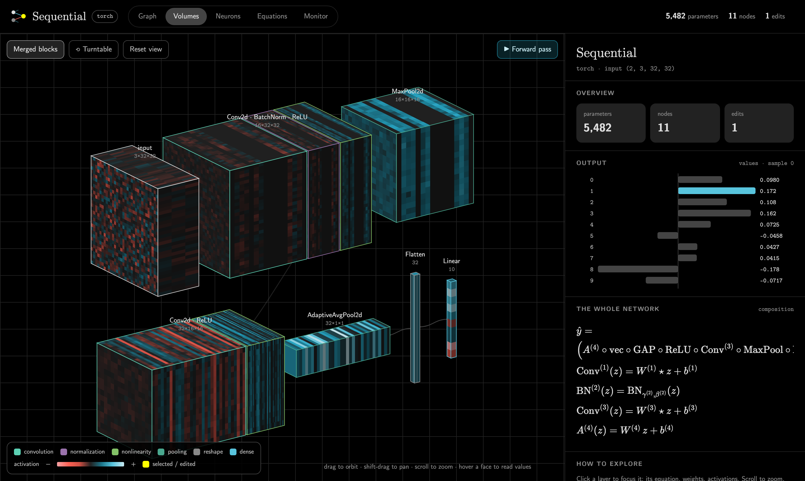

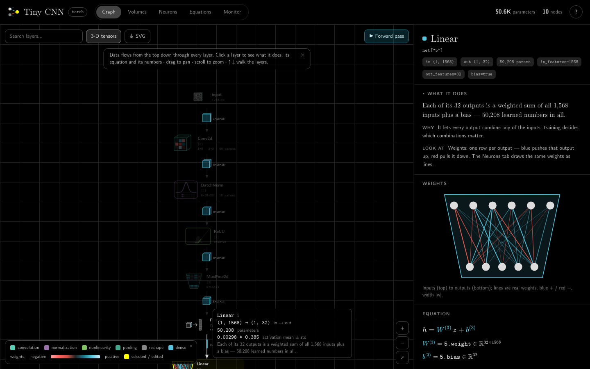

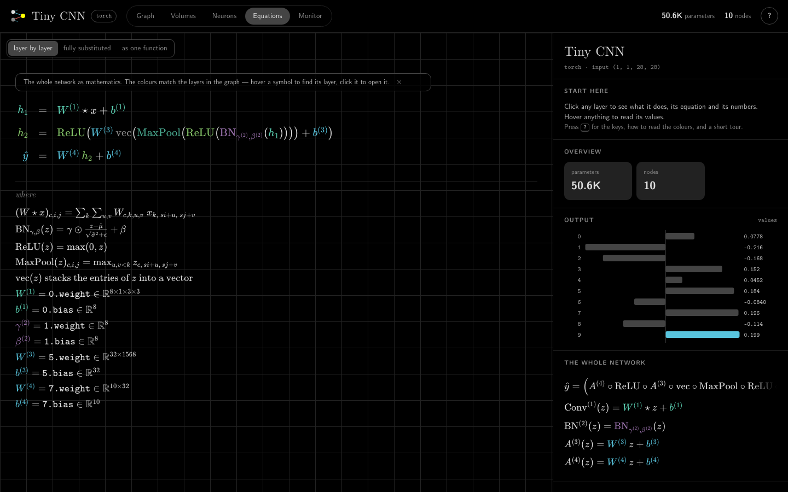

### Export it

```python
dv.export_html(model, x, "model.html",                 # any torch / flax / nnx / equinox model (params=... for linen/pure)
               title="Stroke classifier", note="Trained on synthetic bars and rings.",
               views=("graph", "volumes", "equations"), start="graph",
               depth="all",                            # or an int: collapse containers deeper than it
               style="expressive",                     # "compact" for plain boxes
               tensor_shapes=True)                     # 3-D tensor blocks on every edge
dv.export_svg(model, x, "model.svg", direction="LR")   # static figure; ".html" wraps it in a page
dv.export_svg(model, x, "model.pdf")                   # .pdf for papers, .png for slides (needs cairosvg)
net.export_html(...), net.export_svg(...)              # the same on an already-wrapped net
net.export_html("batch.html", xb, sample=3)            # batched input: which sample the views show
net                                                    # in Jupyter: the figure inline
```

The dashboard's **⤓ SVG** button saves exactly what the graph view shows (current depth, tensors on or off)
as a standalone figure. Without writing code:

```bash
deepvis export torchvision:resnet18 -o resnet18.html -o resnet18.svg
deepvis export hf:gpt2 --random -o gpt2.html               # from the config, no weight download
deepvis export hf:gpt2 --text "The Eiffel Tower is in the city of" -o gpt2.html   # tokens, next-token predictions
deepvis export hf:google/vit-base-patch16-224 --image photo.jpg -o vit.html       # its own preprocessing, class names
deepvis export torchvision:resnet50 --pretrained --image photo.jpg -o r50.html
deepvis export my_models.py:build -o net.html --depth all  # build() returns a module, (module, input) or a dv.Net
deepvis export mypkg.models:MLP --shape 8,784 -o mlp.svg --direction LR
deepvis summary torchvision:convnext_tiny
```

Every component gets its own glyph, drawn from the model's own numbers (the same SVG in the dashboard and
in exported figures; sizes depend only on the architecture, so layouts stay put while you edit):

| component | glyph |
|---|---|
| activation (ReLU, GELU, sigmoid, tanh, SiLU, hardswish, …) | its **real transfer curve** over a histogram of the inputs it received; the range 90 % of them fall in is drawn bold, so saturation is visible |
| dense layer | a trapezoid tapering from in- to out-features, holding a 3b1b-style fan of **sampled real weights** |
| convolution / transposed conv | a 3-D slab (depth ∝ filters) showing its **first kernel** |
| normalization | the input distribution vs the normalized one (equal peaks: the width change is the effect) |
| softmax / output | the **probabilities / values** produced for the input |
| attention | the head-averaged **attention map** |
| pooling / upsampling | a funnel; max-pool highlights the cells it keeps |
| input / tensors on edges | 3-D blocks proportioned by shape — the input shows the **actual image** on its face |
| `+ − · / @` | ⊕ ⊖ ⊙ ⊘ ⊗ |
| LayerNorm / BatchNorm / GroupNorm / RMSNorm | the distributions, over a grid lighting up *what* is normalized together (a token's features / one channel across the batch / a group of channels / hollow: scaled, not centred) |
| split · chunk · unbind | one bar breaking into as many chunks as outputs are used |
| matmul · einsum · bmm | a row of A meets a column of B in one cell of the product |
| masked_fill · tril | the causal triangle |
| rotary embedding | phasors rotating at different frequencies |
| sin, cos, exp, log, rsqrt, pow, … | their real curves over the data (a diffusion timestep embedding shows its sine waves) |
| arange · expand | a staircase · one row copied into several |
| concat, dropout (p), reshape/flatten, transpose, slicing, embedding, LSTM/GRU/scan, parameters (their values), collapsed blocks | a distinct symbol each |

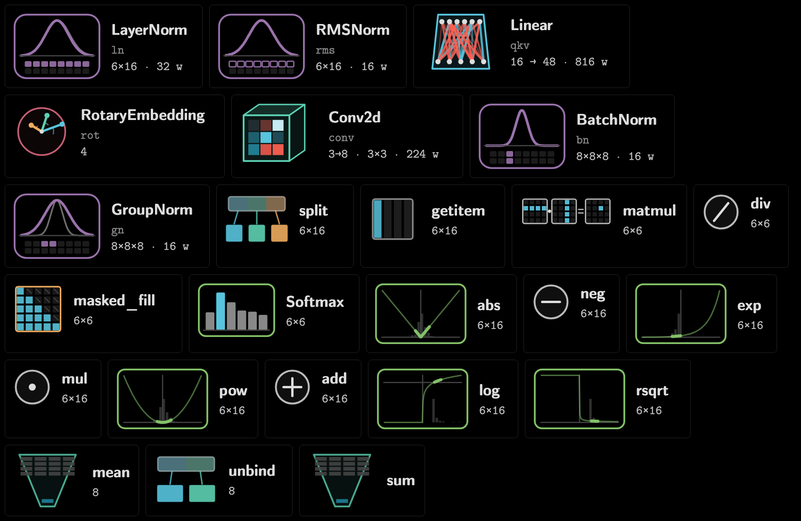

Click a node in the dashboard to see its glyph enlarged with a caption explaining what it encodes.

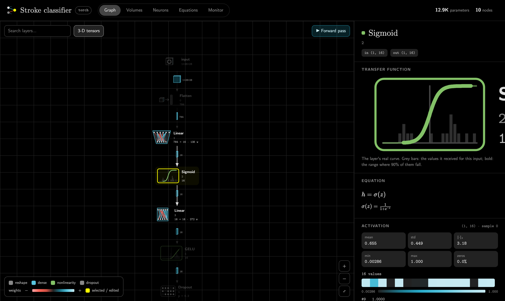

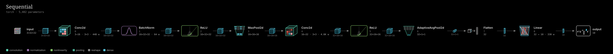

### In your notebook, W&B and TensorBoard

```python
net.widget(x)                                    # the live page as a notebook widget: edits, interventions, the
                                                 # input playground — JupyterLab, VS Code, Colab; no web server
dv.integrations.log_wandb(net, x, step=epoch)    # the interactive page in your W&B run (wandb.Html)
dv.integrations.log_tensorboard(writer, net, step, x)   # weight / activation histograms and norms, TrainingLog curves
```

The widget (`pip install anywidget`) sends the page's requests over the widget's own channel to your kernel, so
it works where a local server can't be reached. A training loop running in the same cell keeps the kernel busy:
run it in a thread to watch live, or use `net.serve`.

### Play with it (live)

`net.serve(x)` runs the same dashboard against your Python process:

* **Input playground** — draw on image inputs (right-click erases), drag sliders for small vectors, type token
  ids for sequence models; add noise, rescale, reset. The whole dashboard re-traces on every change.
* **Weights** — scale / prune / add noise / low-rank / quantize / re-initialize a layer, zero or scale
  individual neurons, **click any weight cell to set it**. Undo, redo, reset, and export the edit log.
* **Activations** — ablate, mean-ablate, amplify, negate, clamp or add noise at *any* node (functional ops
  included), for all neurons or a chosen few; active interventions are listed and removable.

Every browser action is an ordinary deepvis edit or intervention, so `net.history` and `net.undo()` see it
from Python too.

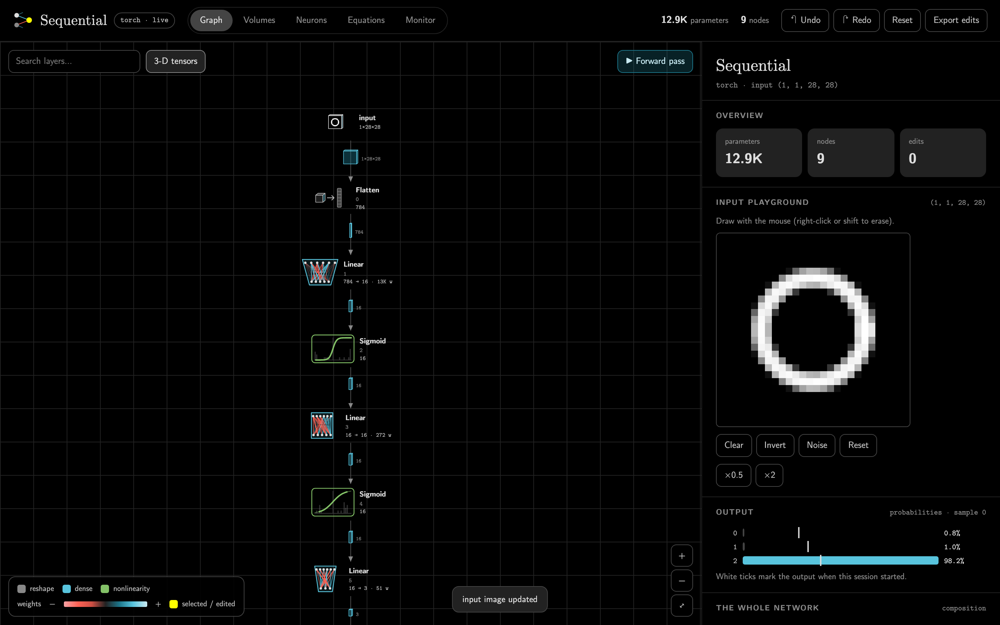

With a batched input, **‹ sample k / B ›** in the header switches which sample every view shows.

### Language models: tokens, predictions, the logit lens

```python
net = dv.wrap(gpt2, sample_input=ids)
net.tokenizer = tok                       # or export_html(..., tokenizer=tok); labels=[...] names classifier outputs
net.export_html("gpt2.html", ids)
lens = net.logit_lens(ids)                # what the model would predict after each block
print(lens.table()); lens.probs(" Paris") # P(" Paris") layer by layer: 0 … 0.003 0.025 0.248 0.183 0.07
```

With a tokenizer the page shows the input's tokens, names both axes of every attention map ("query 9 “ of”
→ key 3 “ Tower”"), and replaces the unreadable 50,257-way output with the **top next-token predictions**
(any output with more than 64 classes gets a top-k view: ImageNet class names come from `labels=`). Names are
only attached when the output really is over the vocabulary / classes — a base model's hidden units are never
labeled as tokens. The **logit lens** (Monitor tab, and `net.logit_lens`) sends every block's residual stream
through the model's own final norm and unembedding, found in the graph: the last row reproduces the real
output exactly, the rows above show the answer forming.

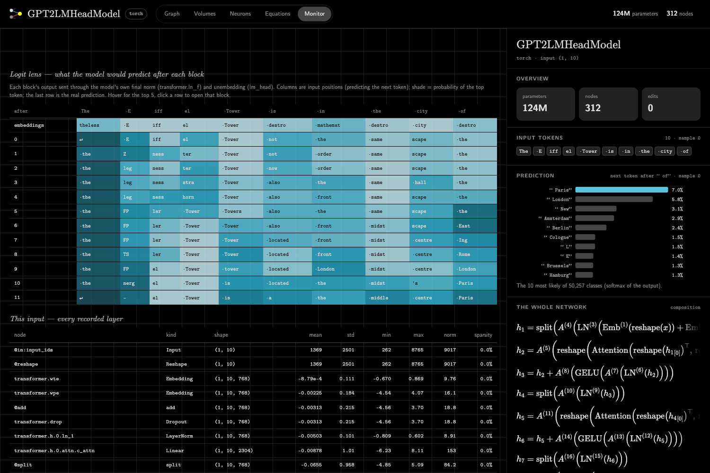

### Inside attention

Every attention layer — `nn.MultiheadAttention` or fused `scaled_dot_product_attention` (HuggingFace, timm) —
gets an **Attention** tab laid out like the matrix products it computes: Q beside the scores with Kᵀ above them,
softmax into P, V above P·V. Hover a query: its row lights up everywhere and V's rows dim by how little they're
attended. Masks (causal, padding) and grouped-query heads included; for image tokens, *where it looks* folds the
row back onto the pixel grid. Q, K, V, scores, P and the head outputs are in `net.trace(x).attention_parts`.

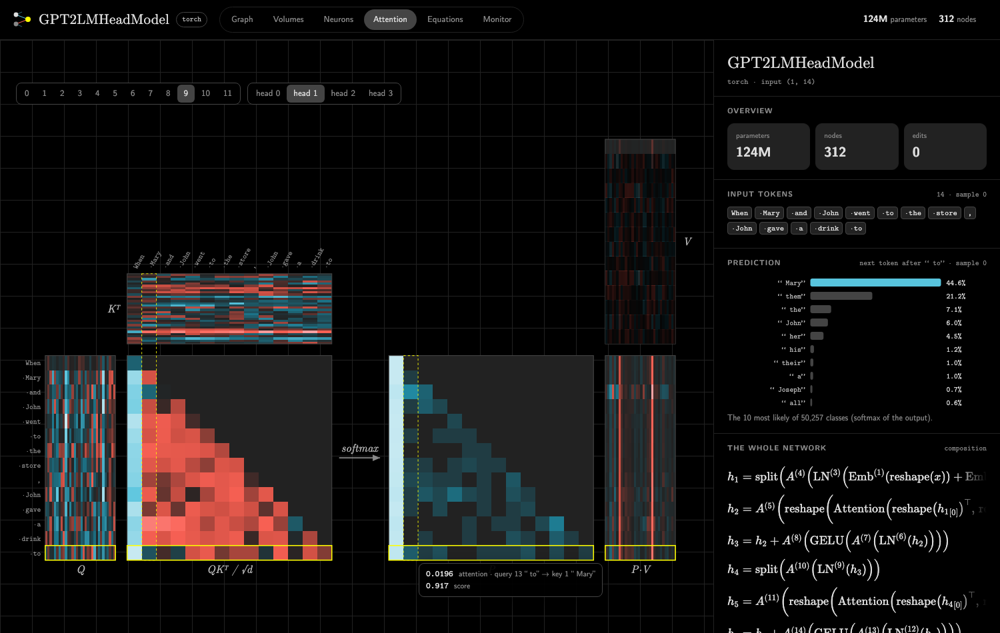

Below the head, **Which heads matter** switches each head off in turn. It shows how much the output moves, as a
layers × heads grid; click a cell to look inside that head. **Where the information comes from** is attention
rollout through the whole stack, drawn over the tokens (or over the image, for a ViT). On a live page,
**Switch head N off** is an undoable edit, and the output bars show the change. From Python:
`net.head_importance(x)`, `dv.interpret.rollout(net, trace)`.

### Why this output?

```python
dv.visualize(model, x, attribution=True)                  # the "Why" section of the Output panel
a = net.attribute(x, method="ig", target=3)              # "ig" | "saliency" | "grad_cam" → a.map
```

Integrated gradients (signed; it adds up to the output's distance from a blank input), saliency, and Grad-CAM,
for the top three predictions. Image attributions are drawn over the image; token inputs are attributed through
the embedding, one colour per token.

### Compare two versions

```python
dv.compare(model, "checkpoints/step_5000.pt", x, names=("base", "fine-tuned"))   # or a model, or a state_dict
```

The **Compare** tab shows, per layer, how far the weights moved (‖W′ − W‖/‖W‖) and how far the activations on
the same input moved, next to both outputs. Layers that changed glow in the graph.

### The network over a dataset

```python
prof = net.profile(test_loader)                      # a DataLoader, (X, y) arrays, or batches of dicts
prof.dead_units()                                    # {"layer3.1.relu": [7, 41], …}
prof.top_inputs("layer4.1.conv2", 12)                # the samples that excite unit 12 most
net.export_html("data.html", x, dataset=prof)        # + a Dataset tab
```

`profile` streams the data through the network once (up to `max_samples`) and keeps, for every layer, each unit's
mean, spread and how often it fires, its **dead units** (never active after a ReLU-like layer, or never changing),
and the **inputs that excite each unit most**. It also keeps a **2-D map of the samples** at every layer (PCA; UMAP
with `embed="umap"` if `umap-learn` is installed) and **linear CKA** between every pair of layers. The Dataset tab
shows the map coloured by label or prediction (hover a point to see the input), the layer-similarity matrix, dead
units per layer and the most exciting inputs, as thumbnails or token windows; every layer's panel lists its own.

### More architectures

* **Recurrent layers** (`nn.LSTM` / `GRU` / `RNN`, stacked and bidirectional) are unrolled over time: hₜ, cₜ
  and every gate at every step. They're recomputed from the weights and checked against the layer's real
  output.
* **Mixture of experts** (HF Mixtral, Qwen-MoE, or your own `gate` + `experts`): which experts the router sends
  each token to, and the load per expert.
* **Mamba / state spaces:** Δ per token and channel, i.e. how much each token writes into the state.
* **Vision transformers and CLIP:** the patch grid on the input picture, attention and rollout drawn on it.
  CLIP's output is image-to-caption similarity (pass the captions as `labels=`).
* **Graph neural networks** (PyTorch Geometric): each message-passing layer is one node, and the input graph
  is drawn and coloured by any layer's per-node features.
* **JAX:** Flax attention gets the same interior view. The logit lens takes
  `lens_fn=lambda h: model.apply(variables, h, method=Model.unembed)`, and page-driven training accepts a step
  that returns the new params (`examples/17_jax_train_in_browser.py`).

### Diffusion

```python
from deepvis import diffusion as dd
run = dd.sample(unet, shape=(6, 1, 20, 20), betas=dd.linear_betas(200), sampler="ddpm")   # or "ddim", steps=50
net = dv.wrap(unet, sample_input=run.probe())          # the U-Net at 8 timesteps of one sample
net.export_html("diffusion.html", *run.probe(), diffusion=run)
```

The **Diffusion** tab plays the reverse process: xₜ, the predicted clean image x̂₀ and the predicted noise ε̂ for
every sample, the whole trajectory, the forward process and the schedule. ‹ › steps the rest of the page
through timesteps (`examples/16_diffusion.py` trains a small DDPM in a few minutes).

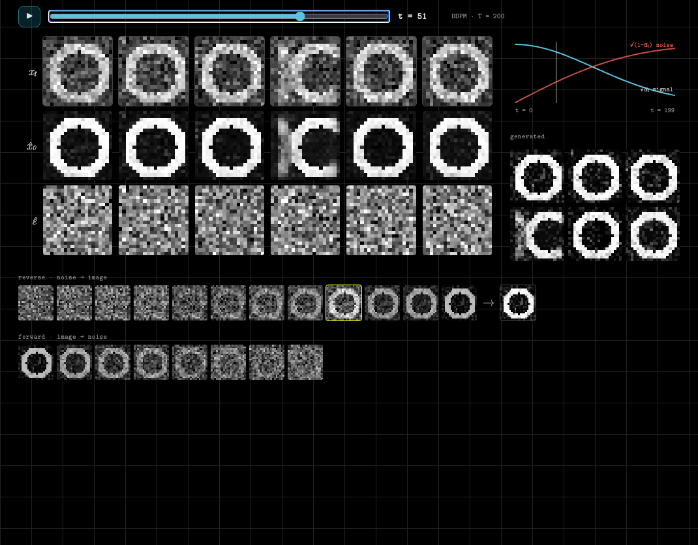

### Train it from the page

Give `serve` one optimization step and the page gets **▶ Train / ❚❚ Pause**, **Step** and **↺ Reset training**
buttons. The loop runs in your Python process; inputs, every intermediate tensor and the outputs refresh as the
weights change (`examples/15_train_in_browser.py`):

```python
def train_step(step):                       # one optimization step -> metrics
    loss = F.cross_entropy(model(xb), yb); opt.zero_grad(); loss.backward(); opt.step()
    return {"loss": loss.item()}

srv = net.serve(probe_x, train_step=train_step, train_steps=600,   # cap the run (optional)
                train_reset=lambda: ...,       # after Reset restores the initial weights, e.g. a fresh optimizer
                train_delay=0.02,              # slow it down to watch
                grads=True, loss_fn=lambda out: F.cross_entropy(out, probe_y))   # live gradient flow too
srv.train("start")                             # the same actions from Python: start / pause / step / reset
```

Each step and every dashboard refresh take turns on one lock, so the page never races the optimizer; a step
that raises stops training and shows the error on the page.

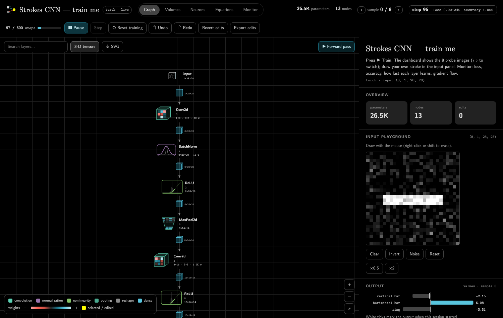

### Watch it learn

The shortest way is `dv.watch`, or a callback for PyTorch Lightning / the HuggingFace Trainer:

```python
with dv.watch(model, x_probe, every=50) as w:               # a live page (in VS Code: beside the code)
    for step, (x, y) in enumerate(loader):
        loss = train_step(x, y)
        w.step(step, loss=loss)
trainer = pl.Trainer(callbacks=[dv.callbacks.lightning(x_probe)])
trainer = transformers.Trainer(..., callbacks=[dv.callbacks.huggingface(batch["input_ids"][:1])])
```

The Monitor tab's **Replay** has a slider and ▶ Play. It steps through the run: every layer's weights as
pictures, on one colour scale per layer, and the output at each step.

Or call `srv.update(...)` from your training loop and the open page follows along:

```python
srv = net.serve(x_probe, start="monitor", snapshot_every=25)
for step, (x, y) in enumerate(loader):
    loss = train_step(x, y)
    srv.update(step, loss=loss.item(), acc=acc)            # JAX: srv.update(step, params=params, grads=grads, ...)
net.export_html("run.html", x_probe, training=srv.training) # a self-contained replay of the run
```

* metric curves (log scale for losses that span decades);
* a **layers × time heat strip** of how fast every layer moves: relative update ‖Δθ‖/‖θ‖ per step
  (typically ~1e-3), gradient norm, weight-norm and output-spread growth; click a row to follow that layer;
* every other view (activation curves, weight fans, 3-D volumes, equations with numbers) refreshes in place,
  keeping your selection, camera and scroll; **Pause updates** freezes the page while training continues.

Metrics are logged on every call; the page state is rebuilt at most every `min_interval` seconds (1 s by
default). The dashboard's forward pass runs in eval mode under `no_grad` and restores every module's
train/eval flag, so BatchNorm statistics and dropout RNG in your training are untouched. Without a server,
`log = dv.TrainingLog(net, every_steps=25)` and `log.record(step, loss=...)` do the same bookkeeping.
`net.load(new_params)` accepts whatever `net.export()` returns (flax variables or params, an equinox model,
a params pytree, a torch `state_dict`); nnx modules trained in place are re-read automatically.

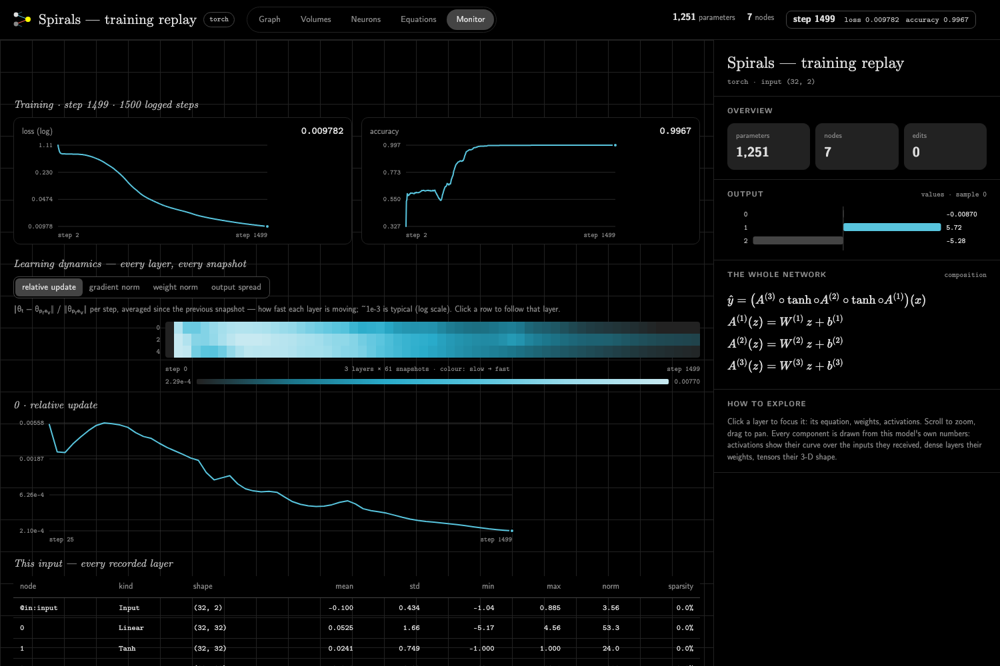

### Animate it (manim)

```python
net.animate("forward", x, path="forward.mp4")          # activations flow layer by layer
net.animate("equation", path="equation.mp4")           # composition → layers → one formula
net.animate("focus", x, focus="fc2", path="focus.mp4") # zoom in, synapses become the weight matrix
net.animate("edit", x, edit={"op": "prune", "target": "fc2", "args": {"amount": 0.8}})
net.animate("architecture", path="arch.mp4")           # any architecture as a block diagram
net.animate("volumes", x, path="tensors.mp4")          # ThreeDScene: tensors as blocks with activation mosaics
net.animate("training", log=log, path="learning.mp4")  # a TrainingLog: the loss curve draws itself while a
                                                       # layers × time grid fills with each layer's update rate
```

Each video narrates itself along the bottom of the frame in plain words with the network's real numbers ("Layer 1:
16 neurons. Each adds up all 784 inputs, weighted (blue +, red −), then applies the sigmoid."); `captions=False`
turns that off. The forward pass, architecture and volumes videos open with the whole network in a sentence; with an
image input, the drawn pixels light up and fly into their input neurons. Equations are colour-coded like the layer
blocks, a neuron's weighted sum colours each term by its weight's sign, and the layer being computed stays bright
while the rest fades to context.

`quality="low" | "medium" | "high" | "4k"`, `fmt="mp4" | "gif"`. The scenes (`deepvis.anim.scenes`, including the
`VolumesScene` ThreeDScene) and mobjects (`NetworkDiagram`, `WeightGrid`, `Block`) are ordinary ManimCE classes
you can reuse.

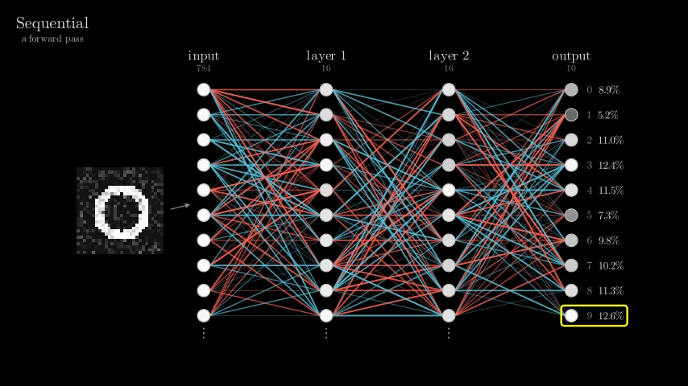

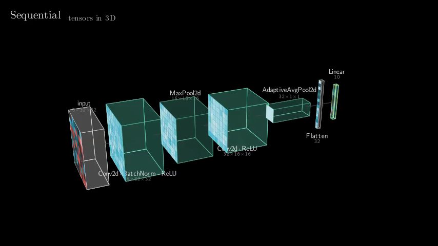

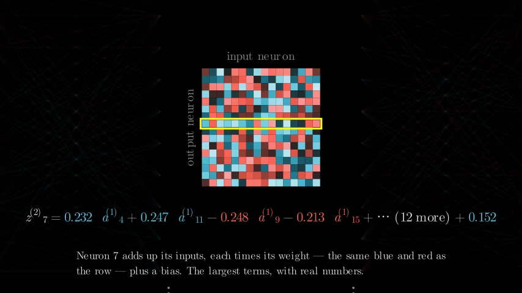
